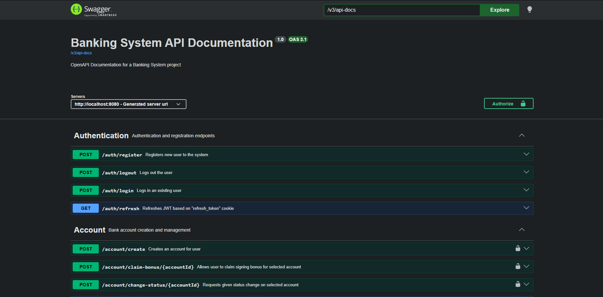

# Banking System
Backend REST API for a simple banking system - user accounts, money transfers between accounts, and an admin-approved account status workflow. Built with Spring Boot, PostgreSQL and Redis, fully documented with OpenAPI (Swagger UI) and runnable with Docker Compose.

> Portfolio project focused on money-handling design (ledger-based balances, locking, concurrency) and secure authentication rather than on the number of features. Verified manually through the API, there are no automated tests yet.



## Features
- **Authentication** with a short-lived access JWT (10 min) and a refresh token stored hashed in Redis, delivered in an `HttpOnly`, `Secure`, `SameSite=Strict` cookie
- **Accounts** - user can have one `ACTIVE` or `FROZEN` account (and any amount of `CLOSED` ones), each user can claim a one-time (per user) signing bonus (transferred from system account)
- **Transfers** between accounts, with a ledger-style balance computed from the transfer history
- **Account status workflow** (`ACTIVE` / `FROZEN` / `CLOSED`) with a full audit log: freezing and closing are applied immediately, unfreezing creates a ticket that has to be resolved by an admin
- **Admin panel endpoints** for listing and resolving tickets
- **Keyset pagination** (UUID cursors) for transfer history and status change logs
- **Role-based access control** (`USER`, `ADMIN`) with method-level security
- **Validation and consistent JSON errors** - one error body format across the API, with each endpoint's possible error responses documented in OpenAPI
- **OpenAPI 3 documentation** generated with Springdoc, can be switched off with one environment variable

## Tech stack
- Java 21
- Spring Boot 4 (Spring MVC, Spring Security, Spring Data JPA, Bean Validation)
- PostgreSQL 16
- Redis 7 (refresh tokens)
- Maven
- Springdoc OpenAPI (Swagger UI)
- Docker + Docker Compose

## API overview
Full documentation with request/response schemas and examples is available in Swagger UI (see [Demo](#demo)) and exported to [`backend/openapi.json`](backend/openapi.json).

| Method | Endpoint                                   | Role         | Description                                                 | Notes                                                             |
|--------|--------------------------------------------|--------------|-------------------------------------------------------------|-------------------------------------------------------------------|
| POST   | `/auth/register`                           | Public       | Registers a new user                                        | Usernames are unique and normalised to lowercase                  |
| POST   | `/auth/login`                              | Public       | Returns an access JWT and sets the refresh token cookie     | -                                                                 |
| GET    | `/auth/refresh`                            | Public       | Issues a new access JWT based on the `refresh_token` cookie | -                                                                 |
| POST   | `/auth/logout`                             | Public       | Cleans and revokes the refresh token                        | JWT is still valid until expiration                               |
| POST   | `/account/create`                          | User         | Creates an account for the current user                     | Only one `ACTIVE` or `FROZEN` account                             |
| GET    | `/account/statuses`                        | User         | Lists the user's accounts and their statuses                | -                                                                 |
| GET    | `/account/status/{accountId}`              | User & Admin | Returns the status of a single account                      | User has to be account owner. Admin can request on any            | 
| POST   | `/account/change-status/{accountId}`       | User & Admin | Requests a status change (freeze / close / unfreeze)        | User has to be account owner. Admin can request on any            |
| GET    | `/account/status-change-logs/{accountId}`  | User & Admin | Paginated audit log of status changes for an account        | User has to be account owner. Admin can request on any            |
| POST   | `/account/claim-bonus/{accountId}`         | User         | Claims the one-time signing bonus onto an account           | Bonus is one-time per user, not per account                       |
| GET    | `/transfer/balance/{accountId}`            | User         | Returns the current balance of an account                   | -                                                                 |
| POST   | `/transfer/transfer-funds/{accountId}`     | User         | Transfers funds from an account to another account          | -                                                                 |
| GET    | `/transfer/transfers/{accountId}`          | User         | Paginated transfer history of an account                    | -                                                                 |
| GET    | `/admin/status-change-logs/tickets`        | Admin        | Lists tickets with resolution type `MANUAL`                 | Can be additionally filtered by request type and resolution status |
| POST   | `/admin/status-change-logs/ticket/resolve` | Admin        | Approves or rejects a ticket                                | -                                                                 |

## Getting started
### Prerequisites
- Docker with Docker Compose

### Run with Docker (recommended)
```bash
git clone https://github.com/tomasz-gutkowski/banking-system.git
cd banking-system
cp backend/.env.example backend/.env
```
Open `backend/.env` file and set `JWT_SECRET` to a value of at least 32 characters. It is required for application to start.
Suggested way of getting compatible value:
```bash
openssl rand -hex 32
```
Then start the stack:
```bash
docker compose up --build
```
If you change database credentials between runs, or want to rebuild from zero:
```bash
docker compose down -v
```
The API will be available at `http://localhost:8080`.


### Environment variables
All variables live in `backend/.env` (template: `backend/.env.example`).

| Variable                                              | Description                                                                  | Default / example                                                |
|-------------------------------------------------------|------------------------------------------------------------------------------|------------------------------------------------------------------|
| `POSTGRES_DB` / `POSTGRES_USER` / `POSTGRES_PASSWORD` | PostgreSQL database and credentials                                          | `postgres` / `postgres` / `password`                             |
| `POSTGRES_HOST`                                       | PostgreSQL host and port (overridden by Compose to `postgres:5432`)          | `localhost:5432`                                                 |
| `DDL_AUTO`                                            | Hibernate `ddl-auto` mode                                                    | `update`                                                         |
| `JWT_SECRET`                                          | Secret used to sign JWTs - **must be changed**, the app validates it         | `CHANGE_THIS_VALUE` (Required, has to be at least 32 characters) |
| `APP_ADMIN_USERNAME` / `APP_ADMIN_PASSWORD`           | Admin account created on startup                                             | `admin` / `password`                                             |
| `FRONTEND_URL`                                        | Origin allowed by CORS (credentials enabled)                                 | `http://localhost:5173`                                          |
| `REDIS_HOST` / `REDIS_PORT` / `REDIS_PASSWORD`        | Redis connection (host overridden by Compose to `redis`)                     | `localhost` / `6379` / `password`                                |
| `ENABLE_OPENAPI`                                      | Enables Swagger UI **and** `/v3/api-docs`; when `false` they are not exposed | `true` in `.env.example`, `false` if unset                       |

## Demo
Swagger UI is available at `http://localhost:8080/swagger-ui/index.html` once the application is running. Raw OpenAPI json is available under `http://localhost:8080/v3/api-docs` and exported to [openapi.json](backend/openapi.json)

Suggested try-it-out flow:
1. `POST /auth/register` - create a user
2. `POST /auth/login` - copy the `jwt` from the response
3. Click **Authorize** (top right) and paste the JWT
4. `POST /account/create` - copy the returned account ID (`ACC-XXXXXXXX`) or get it by listing all accounts belonging to user with `GET /account/statuses`
5. `POST /account/claim-bonus/{accountId}` - claim your initial funds for testing 
6. Register a second user and log in as them. Click **Authorize** again and replace the token with the new one, then create an account with `POST /account/create` and note its ID (it does not need the bonus). 
7. Log in as the first user again and `POST /transfer/transfer-funds/{accountId}` with the first account's ID in the path and the second account's ID as the receiver in the body.
8. As the first user, freeze the account with `POST /account/change-status/{accountId}` (`FREEZE`), then request `UNFREEZE`, which creates a ticket. Log in as the admin (`APP_ADMIN_USERNAME` / `APP_ADMIN_PASSWORD` from your `backend/.env`), authorize with the admin token, list tickets with `GET /admin/status-change-logs/tickets`, copy the ticket ID, and approve it with `POST /admin/status-change-logs/ticket/resolve`.

> The refresh token cookie is `Secure`. Safari may reject `Secure` cookies on `http://localhost`, so testing of `/auth/refresh` and `/auth/logout` is recommended in Chrome or Firefox.


## Design decisions
### Ledger-style balances
There is no stored balance column that could drift out of sync: an account's balance is computed from its transfers (completed received, minus completed and pending sent), so the history is the single source of truth. The trade-off is that the whole history is aggregated on every balance check and transfer, which is fine at this scale; a production system would add balance snapshots.

Money is `BigDecimal` (precision 19, scale 2), and every timestamp is an `Instant` stored as UTC `timestamptz`.

The balance rule already handles pending transfers: they reduce the sender's balance immediately and reach the receiver only once completed. Currently every transfer is created as `COMPLETED`, so the pending state exists in the model but nothing produces it yet.

### Concurrency
Transfers use pessimistic locking, and the accounts involved are always locked in a consistent order, so two opposite transfers (A -> B and B -> A) cannot deadlock. Closing an account takes the same locks, so a close cannot race with a transfer. Concurrency was checked manually with parallel transfers, opposite-direction transfers, parallel registrations/account creations, bonus claims and unfreeze tickets - no deadlocks or inconsistent balances.

### Authentication
- The access JWT lives for 10 minutes, the refresh token for 6 hours.
- The refresh token is stored in Redis only as an SHA-256 hash (which is sufficient for already high entropy value), so a Redis leak does not expose usable tokens.
- It travels in an `HttpOnly`, `Secure`, `SameSite=Strict` cookie scoped to `/auth`, which keeps it out of reach of JavaScript and of cross-site requests.
- Passwords are limited to 8-72 characters (bcrypt enforces 72 byte limit, which can reduce max length with characters exceeding 1 byte) and login uses a dummy hash for unknown usernames to avoid exposing existing usernames through timing.
- Usernames are case-insensitive (lowercased on register and login).
- The JWT secret is validated on startup.

### Account status changes and audit log
Every status change is written to an audit log. User-initiated `FREEZE` and `CLOSE` are resolved automatically (closing requires a zero balance). `UNFREEZE` is the only request that creates a `PENDING` ticket, because a user must not be able to lift a freeze on their own. Admin actions are applied immediately.

### Keyset pagination
Lists are paginated with UUID cursors instead of offsets. Results stay stable while new rows are inserted and the cost does not grow with the page number. An unknown cursor returns `404`.

### Error handling
`GlobalExceptionHandler` maps the application's exceptions to a consistent JSON body (`ExceptionResponse`, or `ValidationExceptionResponse` with per-field messages for validation failures). `401` and `403` responses use the same fields. Malformed requests that fail before validation receive Spring Boot's standard `400` body, which has generic content but same fields as `ExceptionResponse`.

### OpenAPI
Documentation is written with annotations, using composed annotations (`@ApiValidationErrors`, `@ApiAuthenticationErrors`, `@ApiForbiddenErrors`) to avoid repeating error responses on every endpoint. A single variable (`ENABLE_OPENAPI`) turns off both Swagger UI and the spec endpoint, and `SecurityConfig` only permits the Swagger paths when it is enabled.


## Known limitations
- The access JWT is stateless, so it stays valid for up to 10 minutes after logout - only the refresh token is revoked.
- Requests with an invalid body or parameter type that fail before validation get Spring Boot's generic `400`, not the custom validation response.

## Future additions
Not implemented in this project; see my other project for implementations (backend: [riot-rest-api](https://github.com/tomasz-gutkowski/riot-rest-api) and frontend: [paradox-web](https://github.com/tomasz-gutkowski/paradox-web))
- Rate limiting
- Frontend
- Unit testing
